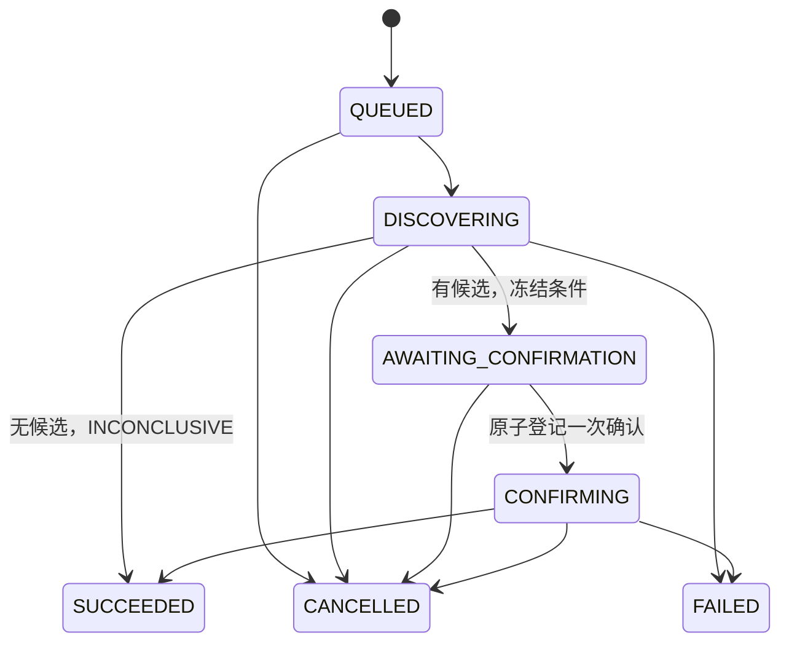
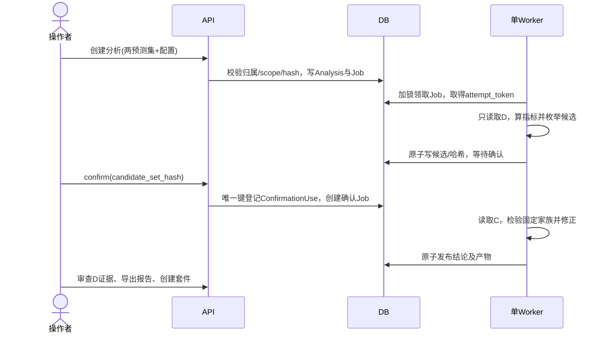

# 领域模型、流程与状态机

## 1. 领域对象

| 对象 | 身份/归属 | 内容与可变性 |
|---|---|---|
| Project | UUID | 名称和描述；所有资源必须同项目 |
| DatasetVersion | UUID，属于Project | 数据、标签、角色、特征目录及其哈希；READY后只读 |
| Sample | dataset_id + sample_id | text/gold/group_id/role/features；随数据版本封存 |
| ModelVersion | UUID | BUILTIN_TFIDF、OLLAMA或PRECOMPUTED；权重/推理/来源指纹、父版本和变更类型；READY后只读 |
| PredictionSet | UUID | 一个模型在一个数据版本/冻结scope上的完整合法输出 |
| Analysis | UUID | 两份完整D+C预测与冻结配置；evidence_mode区分可确认和仅描述 |
| Slice | UUID，属于Analysis | canonical条件、D计数、C聚合结果、统计状态 |
| ConfirmationUse | evaluation_data_sha256+旧新应用内容哈希 | 一次确认的使用登记，不随作业失败删除 |
| SuiteVersion | UUID | 从一个Analysis精选的D样本快照；预算和选择理由；不可变 |
| Replay | UUID | 一个冻结套件与目标模型；包含逐例结果和verdict |
| Job | UUID | 计算状态、尝试号、租约、进度、取消和错误 |
| Artifact | UUID | 内容寻址文件、hash、MIME和类型，不接受客户端路径 |
| Explanation | UUID | 旧合同保留、默认禁用的说明实体；本项目不计划实现生成说明 |
| AuditEvent | UUID | 重要操作的追加日志；非“不可篡改”安全证明 |

## 2. 必须成立的不变量

INV-01：一个sample_id在一个数据版本中唯一；一个group_id只能属于一个role。

INV-02：不同官方分区间如出现同group或归一化同文本关联，导入失败；不自动移动训练样本到测试。

INV-03：所有 gold 和 prediction_label 均来自同一有序label_vocab；标签字符串大小写精确匹配。

INV-04：预测scope预期ID集合与实际ID集合相等；每行恰好一个合法输出。错误/缺失不能当成预测错误或从分母排除。两份预测必须均SUCCEEDED且100%合法覆盖；失败执行只显示覆盖/错误摘要，不产生普通正确率、翻转或统计结果。

INV-05：比较两份预测时项目、dataset_id、labelset_hash、scope_hash一致，scope必须包含D和C；不能在不同数据上比较准确率后称退化。

INV-06：模型输入仅{id,text}；group、gold、role和gold衍生元数据不进入分类器输入。

INV-07：D产生候选；candidate_set_hash在任何C结果读取之前冻结。C上不能添加条件、改阈值、重排候选再重新检验。

INV-08：同一应用版本内容对（不是run_id）在同一evaluation_data_sha256只能确认一次，复制数据UUID/改来源不能重置；崩溃恢复继续同一Analysis，不新建确认使用权。

INV-09：统计状态由服务器算法产生。人工备注、LLM说明、前端按钮不能改变p值/支持量/判定。

INV-10：Suite来源只允许D，样本快照与gold不可改，最多一个相同sample_id。A永不作为suite来源。

INV-11：作业只有持有有效attempt_token的worker可以发布结果；中间文件不被客户端读取。

INV-12：完成状态指向已原子发布并校验hash的产物；不是先写SUCCEEDED再等待文件落盘。

INV-13：已完成Analysis、Suite、Replay与其输入版本不能物理删除；归档只影响列表，不破坏历史。

## 3. 核心状态

Dataset：VALIDATING → READY 或 INVALID。READY → ARCHIVED。ARCHIVED仍可被历史报告引用。

Model：BUILTIN_TFIDF从TRAINING → READY或FAILED；OLLAMA注册时检查已安装模型，仍使用TRAINING作为短暂校验态，检查失败FAILED，成功READY；该状态不表示Ollama在训练权重。PRECOMPUTED校验来源声明后直接READY，但无可执行模型。READY → ARCHIVED。来源哈希格式正确不使外部权重声明变成已核验。

PredictionSet：内置/OLLAMA从QUEUED → RUNNING → SUCCEEDED/FAILED/CANCELLED；PRECOMPUTED从AWAITING_INPUT开始，上传成功后QUEUED。格式验证失败为FAILED，新修正创建新PredictionSet；不得复用已有结果身份。

Analysis不设DRAFT：创建时即冻结配置及evidence_mode。DESCRIPTIVE_ONLY只读D，发现结束即SUCCEEDED、summary=INCONCLUSIVE、summary_reason=EVIDENCE_NOT_CONFIRMABLE，slice保持PROPOSED、所有C字段null；可导出描述报告。其confirm返回409，不读C、不占确认权。CONFIRMATORY须先通过03的来源/稳定性一致性门禁；稳定性不证明因果或确定性。无候选直接完成，不消耗C。确认失败/取消后ConfirmationUse仍存在；允许对同一Analysis发起resume以重做确定性计算，禁止换候选或配置。

Job：QUEUED → RUNNING → SUCCEEDED/FAILED/CANCELLED。RUNNING租约超期：保留attempt日志、增加attempt_no并重新QUEUED，最多3次尝试；超过上限FAILED。人工resume仅对确定性可重做作业，输入不变；产生新Job并指向原资源。对TRAIN失败重新训练必须生成新ModelVersion，避免软件环境变化冒充原模型。

Slice：PROPOSED → CONFIRMED_REGRESSION / NOT_CONFIRMED / INSUFFICIENT_SUPPORT。NO_CANDIDATES是Analysis原因，不是Slice状态。

Suite：BUILDING → READY/FAILED；READY只读。Replay状态为AWAITING_INPUT/QUEUED/RUNNING/SUCCEEDED/FAILED/CANCELLED；其中AWAITING_INPUT仅适用于PRECOMPUTED。verdict单独为PASS/FAIL/ERROR，未完成时null。

### 取消、失败和人工恢复的完整映射

| Job.kind | 取消/最终失败后业务资源 | 人工恢复方式 |
|---|---|---|
| IMPORT_DATA | Dataset INVALID，error.code=CANCELLED或实际失败码 | 修正后新建DatasetVersion |
| TRAIN_MODEL | Model FAILED，error记录取消或失败 | 新建ModelVersion，不复用失败内容身份 |
| PREDICT / IMPORT_PREDICTIONS | PredictionSet CANCELLED/FAILED | 新建PredictionSet；关联Replay同时CANCELLED/FAILED且verdict=ERROR |
| DISCOVER / CONFIRM | Analysis CANCELLED/FAILED | 仅原Analysis的resume；候选/配置/确认使用权不变 |
| BUILD_SUITE | Suite FAILED，error记录取消或失败 | 原Analysis上新建SuiteVersion |
| REPLAY | Replay CANCELLED/FAILED，verdict=ERROR | 新建Replay，不替换旧绑定 |
| EXPLAIN | Explanation CANCELLED/FAILED | P1不提供人工重试入口；分析不受影响 |

自动租约恢复复用原Job/原资源、换attempt_token，限3次；它不同于终态后的人工恢复。EXPLAIN有远程付费不确定性，租约过期直接FAILED/UNCERTAIN_REMOTE_RESULT并保守记账，不自动执行下一次。仅提供Analysis人工resume；其他终态资源必须新建，CLI也遵守同一规则。

### PRECOMPUTED与内置重放依赖

创建Replay时同事务创建SUITE scope PredictionSet并保存绑定。内置/OLLAMA版先排PREDICT；PRECOMPUTED版为AWAITING_INPUT，等待目标PredictionSet的import。开始子作业时Replay进入RUNNING。

预测/import成功的发布事务同时调用`schedule_replay_if_ready`：仅在PredictionSet SUCCEEDED且Replay尚未judge_enqueued时，原子将judge_enqueued=false→true并插入REPLAY Job。该布尔字段与活跃任务唯一索引防重复。Replay终态或已排判定时不再排入。中间崩溃由同一发布事务/attempt恢复解决，不依赖一次性内存回调。

预测/import失败或取消，将绑定Replay置FAILED/CANCELLED、verdict=ERROR，并保存错误。修正预测必须创建**新Replay及新PredictionSet**；旧Replay不允许重绑，避免覆盖历史。

## 4. 比较与确认序列

确认API重试：同Idempotency-Key返回同结果；另一个key但同Analysis已CONFIRMING/SUCCEEDED返回现有任务/资源，不再创建任务。同模型对的其他Analysis返回409 CONFIRMATION_ALREADY_USED。

## 5. 事务边界与失败恢复

领取任务只用短事务`SELECT ... FOR UPDATE SKIP LOCKED LIMIT 1`；训练期间不持有行锁。worker独立心跳线程每10秒续租，主计算按batch检查取消。每次状态写入带`WHERE attempt_token=:token AND lease_expires_at>now()`；0行更新时终止，不得发布。

重试的预测检查点：仅BUILTIN_TFIDF确定性计算可在同一冻结identity/run_id下补缺项，仍须完整发布。OLLAMA、外部LLM推理及可能有概率性的API采用WHOLE_RUN_NO_ROW_MIX：每行只调用一次，不因错误答案或非法输出抽样重试；中断、超时、漂移或响应非法时整份FAILED，保留已生成的受限原始产物，创建新PredictionSet/run_id才能整轮重跑。租约重领发现已有LLM调用迹象即失败UNCERTAIN_INFERENCE_RUN，不拼接不同轮次的成功行。PRECOMPUTED只验证单一run_manifest和全部行，不能把多个run_id拼成一份。网络无exactly-once保证。

文件发布：临时路径→校验→内容寻址正式文件→DB事务写Artifact与最终状态。DB失败留下的孤儿文件仅在维护命令中清理，不能删除活跃/历史引用文件。

## 6. 信息边界

UI案例接口只返回D。C的text/ID允许预测worker和管理员prediction-inputs命令读取，供被测模型推理；C的gold和成对结果在发现算法中不可读，只由确认worker消费并向UI返回冻结分组聚合。A仅实验命令能读取。该限制防误用，不抵抗拥有数据库管理员权限的操作者；论文诚实性仍依赖操作纪律。

训练数据与测试数据的未知外部重叠无法仅靠导入预测检测。PRECOMPUTED报告必须标“训练来源由用户声明，未独立核验”。

## 7. 版本和输入证据新增不变量（1.3）

INV-14：TRAINING_UPDATE必须有同项目父版本、同base revision、不同weights_sha256和TRAIN-only训练清单；父链无环，step严格递增。逻辑回归的嵌套训练数据量链亦属真实重新训练，训练step可为0，以training_config记录fraction。APP_CONFIG_UPDATE要求相同权重、不同推理配置；MODEL_REPLACEMENT不得冒充同模型训练更新；DEPLOYMENT_CHANGE必须说明后端/量化等变化，REFERENCE允许无父。

INV-15：content_sha256是应用版本fingerprint；weights_sha256才标识固定权重。Inference identity包含提示词、标签合同、tokenizer、后端版本、精度、解码和环境。任何identity漂移使本轮预测FAILED/MODEL_IDENTITY_DRIFT，不修改READY版本，而注册新版本。

INV-16：run_id标识一次推理执行；缓存回放不是新推理或独立重复。每份prediction保存raw响应受限Artifact和逐行hash；原始输出按D/C/A同样隔离，报告不附C/A文本。外部provenance_status始终DECLARED；一致性验证不认证训练真实性。
