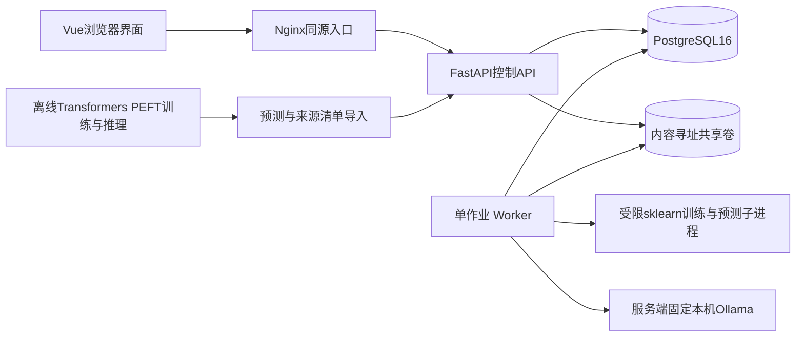

# 总体与详细架构、技术决策

## 1. 结构与部署

设计选择：模块化单体，共用Python领域层；API进程不执行训练/搜索。一个独立worker读取数据库持久队列，P0不加Redis/Celery/Kubernetes。FastAPI BackgroundTasks不承担需要重启恢复的长任务。[S11]

默认业务部署4个服务：web（静态页面+代理）、api、worker、db；模型服务Ollama另由部署者在宿主机安装并预拉白名单模型。Web不安装/下载模型。开发可用本机API与前端开发服务器，db用容器；3060桌面6GB训练在独立离线环境实测，优先原生/WSL2受支持环境，不把GPU透传进业务容器设为必需。Ollama端点连通性须doctor实测；host.docker.internal只在受支持主机上配置，不能假定Linux自动解析。离线训练准备不作为第五个常驻Web服务。

## 2. 技术基线

Python 3.11；FastAPI/Pydantic2；SQLAlchemy2/Alembic；PostgreSQL16；NumPy/SciPy/scikit-learn；Vue3/TypeScript/Pinia/Vue Router；Node24 LTS；Vite；pytest、Vitest、Playwright。Node24的LTS状态已核验[S13]。这些是兼容目标，不伪称已安装测试；M01须生成准确依赖锁并运行最小烟测。若2027年依赖更新，不升级所有大版本再调试，先复现锁定环境。

业务worker只反序列化本项目产生、hash匹配、存储路径不可由API指定的sklearn Pipeline；本地公开模型通过已安装Ollama受限推理，主微调链通过离线Transformers/PEFT训练/推理后导入。Web不加载任意用户模型权重，不执行远程模型代码。sklearn的pickle类持久化不安全，禁止作为任意上传模型功能。[S10]

## 3. 模块与依赖方向

| 模块 | 责任 | 禁止 |
|---|---|---|
| api | DTO、认证、状态码、分页、作业提交 | 算统计/直接训练 |
| domain | 状态、不变量、冻结配置、哈希 | 依赖FastAPI或浏览器 |
| data | JSONL校验、转换、分区、特征目录 | 执行远程加载脚本 |
| models | builtin训练/预测、固定Ollama适配、PRECOMPUTED合同 | 从输入gold推断预测 |
| analysis | 成对指标、D候选、C确认、报告摘要 | 读A/调用LLM |
| suites | 精选、冻结、重放与导出 | 改gold/修改已封存套件 |
| jobs | 队列、租约、attempt fencing、取消、进度 | 无上限重试 |
| storage | 流式文件、内容寻址、原子发布 | 使用客户端路径 |
| explanation | 旧合同兼容占位，始终FEATURE_DISABLED | 不列为计划功能/不接入付费API |
| lab | 固定实验配置、强基线、A评价 | 被网页普通API调用 |

依赖：api/jobs调用应用服务→domain/纯算法；repositories/storage是外部适配。算法测试不启动数据库。

## 4. 作业与一致性

Job.kind取IMPORT_DATA、TRAIN_MODEL、PREDICT、IMPORT_PREDICTIONS、DISCOVER、CONFIRM、BUILD_SUITE、REPLAY、EXPLAIN。

入队与业务资源创建同一DB事务。默认一个worker，一次一个计算作业；等待队列最多100个，满返回429 QUEUE_FULL。领取顺序created_at,id；资源状态不满足前置时任务FAILED并给明确code，不无限循环。

每10秒heartbeat，租约90秒，进度0—100单调（允许重试的计算可重置并展示attempt）；确定性任务自动重领最多3次。OLLAMA/概率性推理若已发出请求，租约失效直接FAILED/UNCERTAIN_INFERENCE_RUN，不能用重领拼接前后两轮；EXPLAIN始终禁用。确认使用权登记先于读取C；确认worker崩溃只允许原候选恢复。取消QUEUED立即CANCELLED；RUNNING写cancel_requested，worker在批次边界确认；60秒未结束时由管理命令停止子进程并标取消，不能声称已立即抢占任意原生库调用。业务资源的取消映射和重放依赖发布事务严格按02，不把Job取消误当业务资源仍在运行。

结果发布用attempt_token作fence。Artifact先临时写入，fsync后同文件系统rename；DB以状态CAS与内容hash发布。每个业务资源最多一个SUCCEEDED最终产物引用；重算创建新资源。幂等键防浏览器重复点击，不保证外部API exactly-once。

## 5. 性能与容量

导入流式解析，错误预览最多100行；单文件100MiB。CPU预测batch=128；Ollama单请求串行，一次只加载一个模型，默认num_ctx=2048（最大4096），num_predict≤128；训练threads=2；统计候选最多20；bootstrap2,000；套件最多500，候选池5,000。病例分页20默认、100最大；表格不一次返回全量文本。API轮询2秒，页面不可见时10秒，结束后停止。

数据行与预测存DB；大报告/模型/原始文件存卷，不能把base64模型塞JSON。SQLAlchemy会话每请求/批次短生命周期。CPU训练worker总超时30分钟；Ollama连接10秒、单样本读取120秒、整份运行硬上限4小时，进度按实际已处理数量显示；离线LoRA不受Web训练超时控制，耗时/显存先用19的32步试训测量，不能把4小时当预计耗时；发现/确认各10分钟；套件10分钟；导入5分钟；超时FAILED/TASK_TIMEOUT，输入保留。这些是护栏，不是预计完成时间。

## 6. 关键ADR

| ADR | 决策 | 理由/代价 |
|---|---|---|
| ADR-01 | P0只做有标签分类 | 金标准明确；不覆盖开放生成 |
| ADR-02 | 离线小模型训练链+预测导入为主要证据，Ollama本地推理为产品入口，CPU为对照 | 明确真实权重更新来源；训练可行性待测，业务不扩成训练平台 |
| ADR-03 | PostgreSQL持久队列 | 一种持久存储，恢复容易；需实现租约而非依赖进程内任务 |
| ADR-04 | 固定D/C/A与一次确认 | 抑制自适应泄漏；功效不足必须暴露 |
| ADR-05 | 确认退化，不做非劣认证 | 避免错误“通过即可安全”结论；发布由用户决定 |
| ADR-06 | 受限JSON谓词 | 可执行可复现，避免自由文本切片和代码执行 |
| ADR-07 | API可选，解释功能退出计划 | 核心可离线验收；普通API不能自改厂商权重，历史解释路由保持关闭 |
| ADR-08 | 单用户令牌，不做账号系统 | 工作量聚焦；公网多人部署需另做安全设计 |
| ADR-09 | 保存fixture和真实数据边界 | 工程正确性不等于科学有效性 |

## 7. 扩展点

ClassifierAdapter协议：`predict_batch(inputs: list[TextInput]) -> list[Prediction]`，TextInput只有sample_id,text。新增adapter不得绕过scope、label、raw响应与run身份校验。OLLAMA只能连接服务端环境变量固定的本机受信地址，只调用/tags、/show、/api/chat；禁重定向、pull/create/delete/upload以及浏览器URL。只开放管理员白名单内已安装tag，注册/运行前后核对digest；固定结构化JSON schema与label enum，think=false须按安装版本支持情况校验。不支持时明确INCOMPATIBLE_MODEL，不自动切换解码方案。API分类如选做须另定P1预算/隐私合同；本版仅支持用户自行运行后PRECOMPUTED导入，外部失败不能转成分类错误。

算法策略接口接收纯数据和冻结config；新增SliceLine策略必须产生相同CandidateSet合同，并走同一个C确认路径。不得让对照方法用不同数据或更少统计惩罚。

## 8. 证据文件与执行隔离

离线准备脚本由19约束：锁定base/tokenizer/source revision、TRAIN-only样本manifest、LoRA配置、代码和依赖、真实日志、每checkpoint权重文件hash；主链推理固定Transformers后端并保存run_manifest/raw响应。不得在主链中把v1放Transformers、v2放Ollama。转换兼容性若做，标DEPLOYMENT_CHANGE，单独报告。原始响应与训练日志只在受限artifacts，普通UI不暴露C/A，失败raw同样隔离。

Ollama模型参数规模/下载大小不等于实际峰值显存；上下文/KV cache和其它进程均占资源。单模型、短上下文是预实验默认，不是适配6GB的保证。模型不可用时可用真实预生成预测完成导入流程，但缓存演示不能冒充实时推理验收；P0另验收一次Ollama真实本地运行。
