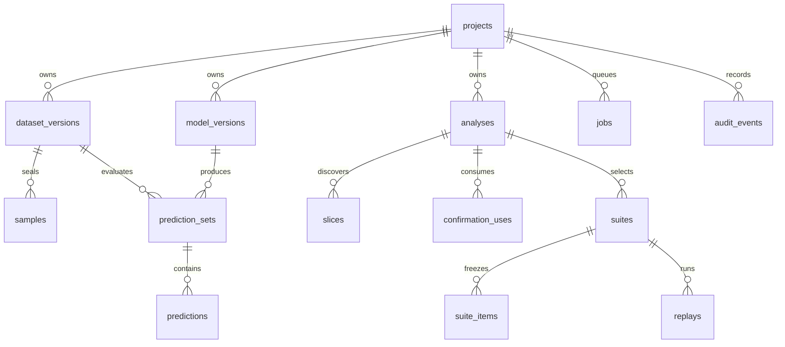

# 数据库设计与持久化约定

初始结构权威：[contracts/schema.sql](contracts/schema.sql)，PostgreSQL16。实际实现以Alembic迁移部署；不同时运行DDL文件与同等迁移造成重复建表。

## 1. 关系

## 2. 字段规范

- UUID由应用生成uuid4，数据库不依赖额外uuid扩展。
- 时间为TIMESTAMPTZ，存UTC，API用ISO8601 Z，界面显示Asia/Shanghai。
- hash是64位小写十六进制SHA256；数组顺序在03/04明确定义。
- 计数BIGINT非负；概率DOUBLE PRECISION限定0—1；未知分母/未完成结果用null而非0。
- 配置/聚合/特征JSONB；高频关联与状态必须结构化列，不全部藏JSON。
- 更新已封存实体内容须拒绝；数据库普通FK保证存在，跨项目一致性由应用服务在同事务验证并做集成测试。

## 3. 主要表与索引

| 表 | 关键字段与约束 | 查询与索引 |
|---|---|---|
| projects | id/name/description/archived_at | created_at,id |
| dataset_versions | project/status/source/version/label_vocab/全部hash/counts/manifest | project,status |
| samples | (dataset_id,sample_id)主键；component_key/role/text/gold/features | dataset,role；dataset,component |
| model_versions | project/kind/status/labelset/content/weights/inference/provenance hashes/change_type/parent/provenance_status/config/training_dataset_id/artifact_id | project,status |
| prediction_sets | model/dataset/scope/scope_hash/status/run_id/inference_config_sha256/attempt_policy/coverage/raw_artifact_id/run_manifest | project,created；model,dataset |
| predictions | (prediction_set_id,sample_id)主键；label/latency/raw_response_sha256 | prediction_set_id |
| analyses | 旧新预测ID/config/hash/candidate_set_hash/evidence_mode/stability_manifest_sha256/stability_artifact_id/status/summary/review | project,created |
| slices | analysis/predicate/hash/D指标/C统计/status/review_flag | analysis,rank；唯一analysis,predicate_hash |
| confirmation_uses | dataset/旧新模型内容hash/analysis | 唯一(evaluation_data_sha256,old_hash,new_hash) |
| suites | analysis/dataset/status/budget/config/content/hash/summary | analysis,created |
| suite_items | (suite_id,sample_id)主键；rank/text/gold/old_label/obligations | 唯一suite,rank |
| replays | suite/model/prediction_set/status/verdict/result | suite,created |
| jobs | kind/resource/state/input/attempt/lease/progress/error | state,created；lease_expires_at |
| artifacts | kind/sha256/relative_path/size/content_type | sha256 |
| explanations | analysis/job/state/body/provider_usage | analysis |
| audit_events | project/action/resource/request_id/detail/time | project,time |
| idempotency_keys | scope/key/request_hash/response/status/expires | 唯一scope,key |

Prediction行的sample_id通过服务检查属于PredictionSet.dataset；数据库跨表复合关系若后续增强，不得改变合同。套件保存文本/gold快照以便独立导出，但同时保留源dataset和sample_id追溯。

## 4. 操作事务

T1上传：临时文件持久化后，同事务建DatasetVersion(VALIDATING)+Job+AuditEvent。导入成功同事务插samples、封存版本和Artifact引用；失败无半份READY数据。

T2成对预测验证：锁模型与数据状态；比较项目、labelset、scope和冻结模型/run身份；禁止使用FAILED/未完成/非法覆盖产物。必须expected=completed=legal且invalid/missing/failed=0，scope非空。

T3确认：锁analysis；核对candidate_set_hash、evidence_mode和稳定性门禁；DESCRIPTIVE_ONLY在任何C读取前拒绝；插ConfirmationUse，唯一冲突409；写CONFIRMING及CONFIRM Job。读C必须发生在T3成功后。

T4发布：锁resource并验证attempt_token；写slice/results/Artifact引用；更新最终状态；写事件；提交。文件先发布后DB引用，孤儿可清理。

T5幂等：事务先占用(scope,key)，request_hash不同409 IDEMPOTENCY_CONFLICT；相同且已完成返回原HTTP状态与响应；正在处理返回409 REQUEST_IN_PROGRESS、Retry-After:2。24小时过期，业务唯一性仍保留。

## 5. 归档、保留与备份

P0不提供物理删除历史的网页按钮；项目归档后不能创建新作业，历史可读。原始数据保留许可信息。演示清空使用新数据库/新volume，不能手写递归删除正在用的存储目录。

每日开发备份不是自动已提供功能：部署手册规定人工`pg_dump`与文件卷共同快照。备份恢复必须校验每个活跃artifact hash；只备份数据库不足以恢复模型与报告。

## 6. 迁移要求

M01建立0001_initial，字段名与DDL一致；schema变更增加迁移，不修改已发布迁移。CI执行空库upgrade→测试→downgrade→upgrade。本文档阶段只静态检查DDL与合同，未声称已在PostgreSQL实例执行。

## 7. 1.3身份、原始响应与跨表约束

`model_versions.content_sha256`是应用版本指纹，`weights_sha256`是base+adapter文件清单身份，`inference_config_sha256`是推理合同，`provenance_sha256`含来源训练记录。parent_model_version_id同项目、无环且不能指自身；TRAINING_UPDATE等条件依03在注册事务验证。`identity_verified=(provenance_status=SERVER_VERIFIED)`由服务端导出；PRECOMPUTED固定DECLARED，不允许客户端自填true。READY后所有这些字段不可改。

`prediction_sets.run_id`全局唯一；导入行run_id必须一致。raw_response在受限Artifact JSONL，逐行`raw_response_sha256`连接到该产物；发布前逐行校验全部hash。coverage是诊断冗余，必须由验证器重算，不接受客户端百分比。原始响应中的C/A与其预测同权限，不通过普通artifact下载入口暴露。

`analyses.evidence_mode`在创建时冻结；stability_artifact_id指嵌入提交、已校验DEV标签重复报告，stability_manifest_sha256是其canonical摘要。该记录验证内部一致性，不认证外部训练。ConfirmationUse采用evaluation_data_sha256+应用版本内容对唯一键，不以run_id重置；再注册同权重同推理不得绕过使用权。数据库引用与文件hash匹配、READY时必需hash非空等须用服务事务/集成测试实现，DDL的普通FK不能单独保证。evaluation_data_sha256是canonical_rows_sha256/labelset_sha256/split_manifest_sha256的摘要，排除UUID/来源元数据；SQL唯一键与T3同事务防止复制数据重置确认。17张表保持不变。
