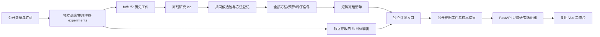

# v2 研究原型架构

状态：通用研究系统的工程设计。已实现的独立CPU预实验入口见[报告](../../experiments/cpu-preflight-v1/README.md)，不等于下列全部模块已完成。研究依据见[范围与决策](01-scope-and-decisions.md)。目标是让实验独立可运行、边界可检查、结果可复现，Web作为已有证据的读取器。

## 1. 三个执行边界



| 边界 | 职责 | 允许数据 | 不能做 |
|---|---|---|---|
| experiments | 数据转换、真实CPU/LoRA训练、固定推理、环境测量 | TRAIN训练、获准DEV开发；正式推理由登记scope驱动 | 不替selector选择有利目标；不把不同run拼接 |
| lab selector | 历史风险、统一基线、HGC、套件冻结 | D文本/gold、f0—f2历史、已登记f2分数/固定表示 | 主访问层不加载f3或C/A逐例结果 |
| lab evaluator | 核验完整矩阵与目标，计分、成本/统计、视图导出 | 冻结套件、同一P的完整f3金标准 | 不重选样、不调参数、不修改原冻结物 |
| backend/frontend | 只读展示及当前v1 Demo兼容 | 校验后的视图bundle、明确允许的D案例 | 不训练、不执行selector、不通过任意路径读取目标 |

白盒Grad-PD可在独立访问层读取f3参数差；目标探测基线也走独立上下文和预算账，不能共用主标签访问层的输入对象。详细分层见[工作流](04-workflow-and-costs.md)。

主比较标记`comparison_scope=CORE_PRE_TARGET`。需要全池f3的基线不能在首次解封前选出套件，因此另用`ENHANCED_TARGET_ACCESS`登记并引用`parent_core_freeze_sha256`：先冻结主矩阵，再授权增强登记取得全池信息、冻结其自身套件并计分。增强方法/配置在目标前预登记，结果不得回流主比较；不能用一个逻辑上无法完成的“全部方法同时先冻结”门禁。

## 2. 仓库现在有什么、未来创建什么

```text
RegressLab/
  backend/                         # 已实现：0.1 Demo；未来增加只读研究适配器
  frontend/                        # 已实现：0.1工作台；未来扩展证据页
  e2e/                             # 已实现：Demo浏览器测试
  examples/                        # 已实现：明确为v1的合成夹具
  scripts/                         # 现有启动/生成；本次文档与历史合同校验
  lab/README.md                    # 本次新增：离线研究代码目录说明，尚无算法代码
  experiments/                    # 已实现：preflight、独立依赖锁、配置与测试
  docs/
    research/v2/source/            # 用户提供的8份原始研究文档，逐字节保留
    research/v2/import-manifest.json
    engineering/v2/                # 本次工程设计、合同、实施与验收
    development/                   # 当前Demo说明、实现状态与开发日志
    experiments/                   # 真实预实验报告与轻量审计工件
    quality/                       # 历史软件验收与本次规划检查
    archive/v1.3/                  # 取代的规格/合同/验证与旧路线
    design/                        # 现有视觉规范及研究展示补充
    screenshots/                   # 历史Demo截图
```

后续完整Python包规划如下；当前不能运行这些模块。`experiments/preflight`已有独立锁定的CPU实现，未来完整包按任务演进，不预造锁hash。

```text
lab/
  pyproject.toml + uv.lock
  src/regresslab_lab/
    cli.py                         # 登记、校验、历史构造、选择、冻结、评测、导出
    contracts/                     # schema加载、跨工件语义检查、协议版本
    data/                          # source_i、组件、分区、共同池
    history/                       # 机会数/负翻记录、严格时间前缀
    groups/                        # 谓词生成、风险估计、外部发现器适配
    selectors/                     # 同接口的基线、HGC、消融
    registry/                      # 来源/访问层/能力、完整预期矩阵
    freeze/                        # 内容寻址、套件与矩阵冻结
    evaluation/                    # 独立目标读取、Recall/分层事件、统计
    costs/                         # 事件账、共享建库与部署单次账
    artifacts/                     # 原子发布、完整性、视图bundle
    simulation/                    # 与真实训练隔离的机制模拟
  tests/{unit,integration,contract}/
experiments/
  pyproject.toml + uv.lock          # 独立锁定；CUDA依赖不装进Web
  src/regresslab_experiments/
    data_adapters/                 # MASSIVE/CLINC150 in-scope
    train_cpu.py / train_lora.py
    inference.py / score_adapters.py
    provenance.py / resources.py
```

## 3. 纯接口与依赖方向

以下签名为计划。类型字段以[领域与数据合同](03-domain-data-contracts.md)及[JSON Schema草案](contracts/README.md)为准；不得各模块复制另一套含义不同的DTO。

```python
build_history_view(dataset, historical_runs, registration) -> HistoryView
build_pool(history: HistoryView) -> PoolManifest
discover_groups(history: HistoryView, pool, group_config) -> GroupSnapshot
select(view: HistoryView, pool, groups, method, budget, seed) -> SelectionResult
freeze_suite(selection, registration, dependency_hashes) -> SuiteFreeze
freeze_matrix(registration, cells) -> FreezeMatrix
evaluate(matrix: FreezeMatrix, target_handle, evaluation_config) -> EvaluationResult
build_view_bundle(evaluation, allowed_cases, costs) -> ViewBundle
```

`select`没有目标路径、目标模型对象、完整Study运行目录或通用任意文件读取回调。Pool与HistoryView的cross-check强制同一dataset/evaluation身份、f2与D角色。评测器验证matrix/registration/P/目标run的一致性，不能只凭“有一个suite文件”解封。

依赖方向：CLI应用层 → 纯领域/selector/evaluation接口 → 类型化存储与适配器。Web读取bundle，不依赖训练环境；现有`regresslab`、未来`regresslab_lab`和`regresslab_experiments`命名空间分开。若提取旧Demo指标，先通过回归测试再让两边调用共享纯函数，不能在规划阶段直接把v1 `domain.py`重命名为HGC实现。

## 4. 文件是研究事实来源，SQLite是索引

本地内容寻址工件是正式研究事实来源。现有`var/demo.sqlite3`继续保存v1 Demo；未来研究索引使用不同文件`var/research-v2.sqlite3`和独立表/迁移版本，不把旧JSON行批量升级成v2研究结果。

SQLite用于study、run、suite、evaluation、成本索引和追加事件，方便恢复/展示。丢失索引时可通过工件校验重建；缺少工件不能从UI汇总数字反造历史。单个离线编排进程、显式文件锁/事务足够；并行GPU训练和多机调度不是当前前置需求。

```text
artifacts/research-v2/<study_id>/
  registration.json
  dataset/dataset-manifest.json
  chains/<chain_id>/chain-manifest.json
  history/<chain_id>/history-view.json
  pools/<chain_id>/pool-manifest.json
  methods/<method_id>/method-manifest.json
  suites/<cell_id>/suite-manifest.json
  freeze/matrix-freeze.json
  evaluations/<evaluation_id>/evaluation-result.json
  costs/cost-ledger.jsonl
  bundles/<bundle_id>/bundle-manifest.json
  events/events.jsonl
var/sealed-targets/<study_id>/<chain_id>/   # 不在selector获准工件根目录
```

数据、权重和大运行工件默认被Git排除；Git提交源码、方法/配置草案、小合成夹具及结果索引。真实工件由显式归档流程生成清单和完整性摘要，不以随手`git add`发布原始数据/模型。

## 5. 发布、恢复与信息边界

每个输出先在同文件系统临时文件写入、校验、flush/fsync，再rename发布内容地址；工件manifest引用已存在且校验通过的对象。SQLite索引随后短事务提交。索引失败的孤儿工件可重建索引，不能把未发布的中间文件显示为成功。

恢复只重做相同配置、依赖身份及确定性计算；旧attempt不覆盖新成功产物。选择重算必须产生相同有序ID/摘要，否则标`NONDETERMINISTIC_SELECTION`并停下调查。模型推理中断新建完整run，保留失败证据，禁止跨run拼行。目标已解封的study不能回退到“未看过目标”状态；修改方案需新登记且原结果保留。

路径隔离、闭合Schema和导入检查是防止误用的工程措施，不抵抗拥有本机全部文件权限且主动绕过协议的研究者。正式实验仍需代码/访问事件/冻结时间与复现审查。白盒/探测基线使用单独上下文，其更强信息条件在结果中可见。

## 6. 技术选择与可完成性

沿用Python、FastAPI、Vue/TypeScript、SQLite。lab计划使用NumPy/scikit-learn/SciPy，按实际安装生成锁；训练环境独立，模型revision/CPU线程/数值精度/硬件写入运行清单。此处不提前承诺具体库最新版、GPU可训性或论文适配已跑通。

HGC/Facility优先实现精确贪心与`O(|U|·|P|)`锚点相似度存储，U最多256；不建全量P×P矩阵。KCenter等可使用稀疏分块更新，不能把所有方法误称为同一个子模目标。先测总耗时与内存，再决定lazy greedy。没有事先冻结的资源裁剪不得静默缩P、减少类别或改预算。执行计划和资源门槛见[07](07-implementation-plan.md)。
