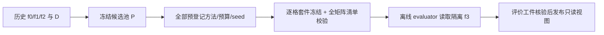

# 05 · 从描述性 Demo 到研究证据工作台

2026-10-23 · 工程设计，尚未实现 v2 页面、接口或离线实验。

本页根据已保留的 [v2 产品范围](../../research/v2/source/PRODUCT.md)、[算法设计](../../research/v2/source/03-algorithm-spec.md)、[实验协议](../../research/v2/source/04-experiment-protocol.md)以及当前前后端源码制定。研究主流程在离线 lab 中完成，工作台读取冻结工件，帮助核对实验、方法、费用和案例。页面开发不代替方法复现和真实实验。

范围与取舍见 [01](01-scope-and-decisions.md)，模块边界见 [02](02-architecture.md)，事实工件与字段以 [03](03-domain-data-contracts.md)及其合同为准，冻结/费用流程见 [04](04-workflow-and-costs.md)，验证见 [06](06-validation-plan.md)，实现次序见 [07](07-implementation-plan.md)。本页的 API 是未来只读投影草案，不是当前 OpenAPI，也不新增一套事实工件格式。

## 1. 当前事实与保留边界

当前可运行程序仍是 Vue 3/TypeScript + FastAPI + SQLite 的描述性 Demo：严格导入 canonical JSONL 和两版预测、校验 D+C 完整覆盖、计算 D 四格指标、发现有限净下降分组、分页查看 D 案例、保存历史和导出 JSON/HTML。现有 `/api/demo` 与 `regresslab-demo-report-v1` 保持原义；已有测试证明的是这些工程行为，没有证明 HGC 有效。

| 当前实现 | v2 处理 |
|---|---|
| `split-v1` 按组件 hash 划分 TEST 为 50%/25%/25% 的 D/C/A | 保留历史记录；v2 拟用 80%/10%/10%，必须生成独立、版本化的分区工件。不能改阈值后重读旧记录冒充同一数据版本 |
| `surface-v1` 包含 locale、长度、否定词、数字、问号，不包含 gold 条件 | 原样保留给 Demo；v2 风险特征允许公开 gold 意图标签，并冻结新的特征定义。不能继续标为旧特征版本 |
| 两版 D+C `PredictionSet`，仅 D 统计 | v2 是 f0→f1→f2 历史视图与隔离 f3，另建 HistoryView、PoolManifest 和评价工件 |
| `_discover` 按 `b>c`、下降≥0.05、支持≥30 找净下降组，最多20组 | 不能充当 HGC 风险发现器。v2 要按每个历史旧正确机会数估计条件翻转风险，区分风险群体与净下降群体 |
| 12 条 D 的 `a=6,b=3,c=1,d=2` 工程夹具；另有96条 D 的分组夹具 | 都是合成软件夹具，继续走 `/api/demo`。不升格为四版真实更新、v2 模拟研究或正式研究数据 |
| 顶部 `DESCRIPTIVE_ONLY / INCONCLUSIVE` 和 C 未执行提示 | 仅保留在旧 Demo。v2 主选样不以 C 确认作为前置门禁；应展示“历史可见 / 套件冻结 / 目标评价”的研究状态 |
| `demo_analyses`、`demo_import_failures` 与原始输入 | 不删除、不自动转为 v2 Study，不在启动时自动扫描成研究结果 |

来源材料所述公开提交 `a702894` 是来源记录，不是本工作区当前提交的替代标识。对当前能力的判断以实际源码及本地验证记录为准。来源 README 引用的 Word 简版未随这8份 Markdown 一同提供，本次没有复核 Word 或其转换图；不能把来源中的交付说明写成本次验证结果。

## 2. 新入口与主屏到工件的映射

保留现有中文浅色壳、语义色、细边框、可访问表格和移动适配，设计约定见 [DESIGN](../../design/DESIGN.md)。新增“研究证据”入口，旧入口明确标“v1 描述性 Demo”。下一版不增加网页训练、GPU调度、登录审批、PostgreSQL迁移或论文方法自动胜出提示。

事实工件根为 `artifacts/research-v2/<study_id>/`。浏览器只传已登记 ID，不提交任意文件系统路径。下列目录相对该根，目标保留文件另放在 selector 根之外的 `var/sealed-targets/<study_id>/<chain_id>/`。

| 视图 | 事实来源 | 可呈现内容与边界 |
|---|---|---|
| 研究列表 / 概览 | `registration.json`、`dataset/dataset-manifest.json`、`chains/<chain_id>/chain-manifest.json` | 研究问题、开发/正式阶段、数据/版本/代码指纹、更新家族、预登记方法与预算、来源等级、研究状态。冻结前 f3 仅为保留目标占位，不展开其工件路径、参数或行为 |
| 历史与群体 | `history/<chain_id>/history-view.json`、方法依赖的风险建模工件 | f0/f1/f2 时间轴、历史负向翻转机会与计数、风险权重、谓词、支持不足及 fallback。只读历史 D；风险率不是未来概率，风险群体不标“已确认净退化” |
| 当前正确候选池 | `pools/<chain_id>/pool-manifest.json` | `P={i∈D:f2(x_i)=y_i}`、`pool_hash`、成员 `source_i`、历史标记、允许特征及 f2 预测。统计 D/P/独立组件数，C/A 仅计数，不进入逐例主视图 |
| 方法与复现 | `methods/<method_id>/method-manifest.json`、`registration.json` | 原样/重实现/适配/启发、论文版本、代码 commit、参数、表示、允许信息、依赖、复现证据与缺项。方法身份与某次运行是否成功分开 |
| 冻结套件 | `suites/<cell_id>/suite-manifest.json`、`freeze/matrix-freeze.json` | 方法×链×预算×选样 seed×访问条件的完整矩阵、单套件顺序 ID/理由/依赖 hash、请求与有效预算、别名关系。每格冻结与全矩阵冻结分别标注 |
| 未来评价 | `evaluations/<evaluation_id>/evaluation-result.json` | 仅在完整冻结且评价完成后显示同池 Recall@B、检出数、分母、完整预算曲线、对照/消融和来源限定。浏览器不重算统计或按正式结果重选比较器 |
| 目标案例检查 | 评价后批准发布的案例投影，绑定 EvaluationResult、PoolManifest 与 SuiteFreeze | 展开 f2/f3 预测、公开 gold、选中方法和历史类型。不能借历史页接口请求 f3；目标全量原始预测不直接作为静态文件暴露 |
| 成本与复现核对 | `costs/cost-ledger.jsonl`、`events/events.jsonl`、上述依赖 | 建库、历史推理、选择、探测、预算推理、研究全池金标准等两本账；单位、实测/估计、缺测和复用条件。目标有关实际明细在评价完成前不进入普通视图 |
| 证据包与导出 | `bundles/<bundle_id>/bundle-manifest.json` | 核对文件清单与 hash 后的只读投影。包是显式发布产物，不因某目录能读取就自动登记为正式研究 |

来源采用三个独立维度：数据性质（工程夹具 / 可控模拟 / 真实记录）、来源核验状态（外部声明 / 已做何种核对 / 未知）和研究阶段（开发 / 正式）。真实记录仍可能只是提供者声明；hash 一致只证明读到的内容未变，不证明执行或训练真实。未知来源使用明确的未知值与原因，不填占位权重 hash。`source_i` 必须来自真实来源身份的稳定 hash；显示名、Demo 样本 ID 和数据库 UUID 不能替代该身份。

## 3. 冻结与解封在页面上的表达

研究状态沿用领域合同：`REGISTERED → DATA_READY → HISTORY_READY → SELECTING → SUITES_FROZEN → EVALUATING → EVALUATED → PUBLISHED`。失败/阻塞有独立原因；`UNSEALED` 是审计事件，不另设可跳过冻结的页面状态。

1. `SELECTING` 屏可查看历史、允许特征、候选池和已完成的套件，不能查看任何 f3 错误、分数、逐例预测、梯度、权重差或目标病例分母。不能只在 CSS 折叠；服务端投影中不包含这些字段，也不给下载链接。
2. 单格“已冻结”不能显示成“已全部冻结”。全矩阵卡列出预登记单元总数、已冻结、尚缺、失败、明确不可用及有效预算别名。完整性由服务器核对 registration、pool、方法和套件依赖 hash，前端不靠格子数量猜测。
3. 缺少 f2 合法分数的方法在预登记阶段标 `UNAVAILABLE` 并说明原因，可采用预先声明的标签访问研究范围；CPU 方向梯度强参考等必做项不能靠隐藏行消失。运行失败的必需单元是 `BLOCKED`。全矩阵只接受必需单元已冻结，或按合同在评价前明确登记的不可用及范围降级；不能看过目标后排除失败方法。
4. 目标文件即使离线已存在，也必须在 selector 可见根之外。界面“未查看”不能证明未泄漏；服务端需核对访问日志、输入白名单与目标隔离证据。未满足时标探索/污染原因，不修饰为正式保留评价。
5. `SUITES_FROZEN` 后只展示“目标未导入/尚未评价/正在评价”的状态和冻结清单，不展示部分目标结果。全部评价完成且依赖核验通过后，才开放结果和目标案例检查。缺失、非法标签、混合运行、scope 不符不作普通分类错误，也不删行后发布较好指标。
6. 主标签访问层、参考分数层、白盒层、目标探测/全池目标层分别显示访问标签。主协议不使用目标信息；增强访问方法只按其预登记条件运行，不把其目标结果回灌主 selector。额外探测须计预算和费用。
7. 不提供网页“解封/执行评价/调参重跑”按钮。本轮新 API 全为读取；套件冻结、登记和评价均由离线 lab 生成工件，状态来自工件与审计事件。

上述冻结卡按`comparison_scope`区分：主表CORE_PRE_TARGET完整冻结后才首次解封全池目标；全池增强表ENHANCED_TARGET_ACCESS展示父主矩阵hash、自身登记/输入授权、增强套件冻结与评价状态。后者选样需要已声明全池目标，不能用主表“零目标访问”的徽标，也不以其晚冻结判成主矩阵失败。增强配置须有目标前提案证据，任何结果不得回流父主表。冻结前隐藏的是公开UI的目标细节，不抹去受控白盒/探测方法的实际访问声明。

C/A 的独立净下降审查是可选扩展，显示在独立诊断区域。没有 C 结果不阻止 HGC 选样或未来 Recall 评价；C 未确认也不能删除某风险组后重选套件。扩展确认的检验与校正义务仍按协议保留，不与选样质量混为一个“通过”标签。

## 4. 方法、指标与成本的显示合同

### 方法复现与信息访问

每行同时呈现 method_origin、实现依据/版本、已完成复核层级、运行状态及缺项原因。例如“Ref-DeepGini：使用 f2 完整合法类别概率的重实现”“Behavior-Anchor：启发式适配，未复现完整 IRT”。论文链接可访问与程序已跑通是两种状态；不能只放“已复现”复选标志。

方法详情列出历史版本数、是否读取公开 gold、f2 分数定义、特征/表示拟合范围、是否读取 f3 参数/梯度或探测预测、探测上限，以及需要但缺失的字段。仅有生成标签首 token 概率不能显示为完整意图分布；分数不可比较时显示原因，不伪造 entropy/DeepGini。正式主比较器与允许阈值从登记工件读取，不能在页面按评价结果重新选择。

### 未来翻转指标

主表以同一个 P、链和访问条件比较。每点至少展示 `B_requested`、`B_effective=min(B_requested,|P|)`、实际唯一选中数、检出数、`|R*|`、Recall、Precision 和适用/不可用原因；字段名最终以03合同为准。增强访问另列目标探测数、实际唯一目标样本数和调用次数，不能把“选中B条”当成总执行预算。重叠探测与套件的去重口径由费用/预算合同明确。

| 情况 | 页面表现 |
|---|---|
| `|R*|=0` | `Recall@B = NA · 本链无未来负向翻转`，保留链与零分母；不显示0%或100%，不从汇总中悄悄删除 |
| `|S|=0` | Precision 显示 `NA · 无选中样本`；空池与未运行分开。该单元按合同记录，不能伪造空套件成功 |
| 全池翻转率为0 | Enrichment 为 NA，并保留分母解释 |
| `B_requested>|P|` | 同时显示请求/有效预算及池不足。多个请求预算映射到同一有效预算时标别名，不计成多个独立研究样本 |
| 评价失败或未完成 | 显示未执行/执行错误与原因；不显示部分 Recall、排名或目标案例 |
| 随机选样多个 seed | 显示链内汇总与全部种子，不把20次选样当20条独立模型更新 |

评价后目标案例至少区分以下集合。这里“未见”指该样本过去没有负向翻转记录，不能据此声称发现了全新语义根因。

- **历史未见未来翻转**：属于 R*，且 f2 之前任一历史转移均未负向翻转。
- **修复后复发**：属于 R*，过去曾负向翻转，至 f2 已恢复正确。
- **历史翻转已修复且本次保留正确**：过去曾翻转，f2/f3 均正确，用于检查历史风险已失效的反例。
- **当前正确并继续正确**：其余 P 中未发生本次负向翻转的样本。

前两类各报集合大小、检出数与 Recall 的独立分母，不能用总 Recall 代替。f2 当前错误的样本不在 P；不把其 f3 错误塞进 Recall 分母。历史四格图仍可复用，但目标主屏不以“总体准确率下降”取代 Recall@B。选中套件的准确率带选择偏差，不显示为全池无偏估计。自然数据没有穷尽的真实群体标注，不展示“真实群体召回率”。

### 两本费用账与缺测

成本面板分别呈现“已有完整历史的一次未见更新”和“从零建库”：前者读取 `T_select + T_probe + T_infer(B)`，后者额外计 `T_build`，并与同次全池目标推理的实测费用对照。训练、清理/嵌入、历史推理、风险建模、梯度/PCA、选择、目标探测、预算推理、研究全池金标准分别列项；研究全池 f3 费用不能隐藏成部署省下的费用。

每项显示单位、测量方法、机器/运行标识、时间戳、缓存复用、实测/估计/缺测及依赖 hash。缺测为 NA，不补0；不由 B/n 推导金钱节省，不将估计曲线混画成实测曲线。累计链和检查点相关，成本优势与统计优越/非劣分开报告。滚动监测若没有完整刷新历史方案，明确“不在本次一次更新协议内”，不计算无依据的未来回本次数。

## 5. 未来只读 API 草案

拟定命名空间 `/api/research/v2`，当前不存在。独立客户端/类型与 `/api/demo` 并存，禁止把任意旧 Demo JSON 自动判定为 v2。API 返回事实工件的已核验投影，不调用训练、selector、统计重算、冻结或解封流程。响应应声明已支持的 schema 版本；当前合同草案为 `research-v2-draft1`，不是稳定发布版本。正式字段和 schema 引用以03为准。

访问层沿用合同的 `HISTORY_LABEL_ONLY / REFERENCE_SCORES / TARGET_WHITEBOX / TARGET_PROBE / TARGET_FULL_POOL`，页面用中文解释并保留可核对的原值。尚未准备完成的草稿允许相应 `content_sha256=null`；声称 READY/FROZEN/EVALUATED/SUCCEEDED 的工件必须有真实且通过核验的内容hash。来源未知与工件内容可核验是两回事，不因未知权重来源而补造hash，也不因草稿hash可空而接受“已冻结但未校验”。

| 计划 GET 路径 | 投影形状 / 主要门禁 |
|---|---|
| `/health` | `{mode, read_only:true, supported_schema_versions, capabilities}`，与 Demo 能力分开 |
| `/studies` | `{items:[{study_id,name,phase,evidence_kind,state,integrity_status}],total,page,page_size}`；仅列显式登记包 |
| `/studies/{study_id}` | `{registration,dataset_summary,chain_summaries,freeze_summary,available_views,limitations}`；冻结前返回脱敏目标占位 |
| `/studies/{study_id}/history?chain_id=…` | `{history_view,pool_summary,groups,page}`；只允许 f0/f1/f2，拒绝 `version=f3` 等越界请求 |
| `/studies/{study_id}/pool?chain_id=…&page=…` | `{pool_manifest,items,total,page,page_size}`；items 仅来源 ID、历史与允许特征，不包含目标字段 |
| `/studies/{study_id}/methods` | `{items:[{method_manifest,reproduction_status,availability,reason}],registration_hash}` |
| `/studies/{study_id}/suites?chain_id=…` | `{matrix_summary,items:[{cell_id,suite_manifest,state,budget_alias}],complete}`；未完成与不可用原因逐格可见 |
| `/studies/{study_id}/evaluations` | 评价前 `{items:[],availability,reason}`，不带目标计数；完成后列 EvaluationResult 摘要及完整性状态 |
| `/studies/{study_id}/evaluations/{evaluation_id}` | `{evaluation_result,scope,artifact_refs,limitations}`；须全矩阵冻结、评价完成、来源/依赖匹配 |
| `/studies/{study_id}/evaluations/{evaluation_id}/cases?category=…&page=…` | `{items,total,page,page_size}`，仅评价后批准案例；越界为明确错误，不能通过筛选参数绕过门禁 |
| `/studies/{study_id}/costs` | `{entries,accounting_views,missing_measurements,access_summary}`；未评价时无目标结果/相关实际明细 |
| `/studies/{study_id}/bundles/{bundle_id}` | 只读 BundleManifest 与已批准下载引用；只下载发布清单白名单，不能从任意路径获取目标保留文件 |

列表游标/页码、错误 envelope、实际枚举以合同收敛，不据本草案生成“已实现”接口文档。候选错误码应区分 `UNSUPPORTED_SCHEMA`、`ARTIFACT_INTEGRITY_ERROR`、`DEPENDENCY_MISMATCH`、`MATRIX_NOT_FROZEN`、`TARGET_SEALED`、`TARGET_MISSING`、`EVALUATION_NOT_COMPLETE`、`NOT_FOUND`；错误详情不得带目标预测或原始响应。

当前静态服务用 `StaticFiles(html=True)` 挂载 `/`，并没有任意路径的 SPA fallback。新页面如采用 hash 路由，可从 `/#/research/v2` 进入；如改为路径路由，需明确加受限入口 fallback，并把新 API 注册在静态挂载之前。不能只在导航里添加一个会返回404的深链接。

## 6. 空态、加载、错误与不支持状态

| 触发 | 必须呈现 / 可以继续的工作 |
|---|---|
| 没有 v2 包 | “尚无登记研究证据”，给出计划 lab 工件位置与操作说明，保留旧 Demo 入口。不能默认载入工程夹具并标研究已完成 |
| 包只有历史 | 展示历史/池/方法状态；目标栏显示“保留目标尚未评价”。历史有用，不因此将整项研究标失败 |
| 正在读取/切换 Study | 保留明确加载态并隔离旧数据；使用独立请求代次或取消机制，旧响应不得覆盖新 Study，也不得把旧目标案例留在新历史页 |
| 不支持 schema | 显示实际/支持版本、包标识和解决路径；拒绝渲染指标，不猜字段、不按 v1 默认值降级解释 |
| hash 或依赖链不符 | 展示损坏/不匹配状态和非敏感定位信息，停止指标/案例发布；不让浏览器“修复 hash” |
| 缺历史版本或 P | 阻塞依赖它的视图，保留已核验的元数据；不能假装三版数据拥有四版修复复发证据 |
| 缺分数或白盒依赖 | 方法显示不可用与访问范围；不是0分或被算法击败。是否允许范围降级只读预登记决定 |
| 缺套件/必需格失败 | 全矩阵保持未冻结，列出具体缺项；不开放部分目标评价 |
| 全矩阵冻结但缺目标 | “目标尚未提供/未执行”；展示冻结证据，不伪造 Recall 或默认0个翻转 |
| 目标/评价执行错误 | 错误与分类翻转分开。失败不进入比较排名，不选择性展示已成功部分 |
| 离线服务中断 | 保留已显示结果及其来源/读取时间，明确无法刷新；恢复后重新核验，不能把网络错误改写成研究失败 |
| 案例筛选无匹配 | 展示所选类别与0项，提供恢复全部；0项与 sealed/NA/错误区分 |

界面正文、状态和错误均转义；不要把工件附带 HTML/Markdown 当页面模板执行。标签、hash、长来源 ID 允许换行或局部滚动。移动正文12px、辅助11px和主要触屏目标44px沿用已修复的实践；D/C/A 不回到逐字纵向布局。目标原始响应只有未来有明确用途且通过发布合同后才能单独加入，不随普通案例默认传回。

## 7. 当前代码：复用、提取与替换清单

这是源码核对后的计划，不表示已完成提取。相对根目录的实际位置如下。

| 实际函数 / 模块 | 可复用部分 | v2 必须增加或替换 |
|---|---|---|
| `backend/src/regresslab/domain.py`: `parse_jsonl`、`_load_json`、`_unique_object`、`_reject_constant`、`_utf8` | 严格 UTF-8、重复键/非有限数/空行拒绝等通用解析规则 | 为 v2 JSON/JSONL 工件各自做 schema 校验，不能把“可解析”当“可用于正式研究”；不得自动补字段 |
| 同文件 `_canonical`、`hash_json` | 稳定 JSON 编码与内容 hash 基础 | 与03的 canonicalization/version/文件原始 hash 明确对齐；先固定测试向量，不能更改旧记录算法以适配新合同 |
| 同文件 `normalize_text`、`surface_features` | 现有 NFKC/空白规则及语言表面特征实现可作为版本化起点 | 跨语言同源组件、真实 `source_i`、新特征目录（含公开 gold）、冻结长度边界等另建；旧函数无 gold，不能伪称已实现 HGC 特征 |
| 同文件 `validate_dataset` | 唯一ID、标签冲突、组件连通、分区泄漏等检查思想可提取 | 它绑定5000行、旧字段、TRAIN标签和50/25/25，不能直接做 v2 数据准备。v2 新 DatasetManifest、DEV双用途隔离及80/10/10需独立实现 |
| 同文件 `_scope`、`validate_predictions` | 标签合法性、同运行、一一覆盖、raw标签一致性的校验逻辑 | 固定 D+C scope、UUID run和生成标签原始输出合同属于 Demo。v2 要显式按历史/目标/分数工件范围校验，防止 f3 混入历史；分类头分数不是现合同 |
| 同文件 `_metrics` | 提取四格计数与普通成对准确率的纯函数，保留已有算例 | 当前同时计算冻结全标签宏F1（无分母类取0）并依赖完整 rows。未来 Recall/Precision/Enrichment、各类别分母、预算和NA需新 evaluator；宏F1范围/缺类口径另行声明，不能整块复用成主评价 |
| 同文件 `_discover`、`analyze`、`DEFAULT_CONFIG` | 旧净下降枚举可保留为有准确名称的诊断对照 | 不改名HGC；新历史风险、收缩权重、去重、P、锚点、精确贪心与全部基线在 lab 实现，不在 HTTP 请求中运行 |
| `backend/src/regresslab/main.py`: `failure`、`LocalRequestGuard`、`create_app` | 错误 envelope、本机服务、受限来源、静态资源组织可复用 | 研究只读路由与 schema/完整性错误分离；现 DomainError详情白名单不含研究字段，需明确扩展。`build_record`、`import_analysis`、`fixture`仍只属于旧Demo，不作为研究发布入口 |
| `backend/src/regresslab/storage.py`: `Store.load/check`、连接事务模式 | 不可覆盖保存、读后 hash核验和完整性检查经验 | `demo_analyses` payload/summary固定两版D指标。研究事实以本地工件为主，SQLite可作独立可重建索引，不改表后静默混入旧记录；不因此要求PostgreSQL |
| `backend/src/regresslab/reports.py`: `render_html`、`report_payload` | HTML纯文本转义、无脚本报告与下载机制 | v1报告schema与“仅D/未确认”语义保留；研究报告从批准bundle生成独立版本，包含访问/冻结/费用/NA，不套壳旧schema |
| `frontend/src/api.ts`: `ApiError`、`checked`、`api`、`downloadReport` | 错误处理、fetch/下载基础可以提取 | 当前 `BASE='/api/demo'`，另建 research client和schema守卫；研究下载只读白名单，不能复用旧analysis导出地址 |
| `frontend/src/App.vue`: `date`、`shortHash`、`message`、`go`、`percent/points`的格式化基础 | 时间/hash显示、导航、反馈和请求代次模式；提取卡片/表格/分页/病例组件 | `percent(null)`只说“无可用分母”，不足以区分研究NA/未执行/错误。`initialize/refreshHistory/selectAnalysis/loadCases/loadFixture/submitImport/exportAnalysis`全部绑定Demo类型和流程，保持旧入口后另建研究页面状态，不直接改一个BASE迁移 |
| `frontend/src/types.ts`、`Icon.vue`、`style.css` | 图标、可访问样式和基础布局 | `Analysis/Metrics/CasePage`仍是两版D合同；新增Study/History/Pool/Freeze/Evaluation视图类型。旧 outcome仅四格，目标案例还要历史未见/修复复发分类 |
| `backend/src/regresslab/cli.py`、`scripts/demo.sh`、`scripts/setup.sh` | 本地启动和doctor的工程入口 | 当前CLI只有demo/doctor，没有训练、select、freeze或evaluate。计划lab CLI另列，不能把文档命令写成已可执行 |

## 8. 一个增量版本：只读证据浏览 Demo

下一次 Demo 只完成“离线工件→核验→只读研究视图”的纵切面，不同时承诺完整HGC实验或神经训练。先按合同制作独立、标记清楚的 v2 工程夹具：四版历史时间轴、冻结池、至少两个对照方法的预算矩阵、NA零翻转/目标缺失/损坏依赖分支、评价后案例与两本成本账。夹具固定预期只验证程序，不能出现在正式收益表里。

实施顺序：先建 v2 schema/工件验证与登记索引，再加只读 API，随后提取现有UI基础组件并增加研究入口，最后完成发布包导出与桌面/移动验收。真实CPU四版链与方法实现属于lab后续里程碑；只有工件通过同一核验并明确登记后，才允许加载真实结果。

该增量版的完成标准：

1. 原 `/api/demo`、现有30行基础数据/12对D结果、96条D分组夹具、SQLite历史和JSON/HTML导出行为保持一致；备份后能继续读取原记录。没有自动把旧ID、配置或夹具转换为v2。
2. 支持显式登记的合法v2工程证据包，未知schema/缺依赖/hash篡改/不合法来源身份均给出可操作错误，不产生正式Study。
3. 冻结前任何新接口、前端状态、下载与错误详情中均无f3预测/分数/路径/目标错误计数；延迟响应和切换Study测试也不能泄漏或串数据。
4. 全矩阵卡与实际registration逐格一致：缺必需格不能冻结；不可用需预登记原因与范围；请求/有效预算别名可追溯。C未执行不阻塞主选样矩阵。
5. 评价完成后才开放目标检查；Recall与历史未见/复发分母核对冻结P，零翻转NA、空池、预算不足、重复有效预算、执行错误等分支均有确定预期。
6. 方法面板准确显示适配/重实现和访问层，缺合法f2分数不伪造分数基线；成本支持缺测/估计与实测分开，研究全池金标准单列。
7. 已有软件测试保留，新增验证聚焦schema/依赖/解封边界、评价算例和真实页面流程；桌面与360px下主要操作可到达，错误/加载/空态/非支持状态可读。具体测试证据按06记录，未执行项不得写PASS。

当前仍未实现：v2工件读取器、上述只读API、研究页面、四版真实CPU链、HGC/强基线运行、正式预算矩阵、真实费用和目标评价。完成新Demo只说明证据链可被正确展示，不代表研究方法通过G2/G3，也不代表满足正式论文结论要求。

## 9. 主要迁移风险

最容易出现的错误是用旧Demo的形状掩盖新协议：两版结果被称为四版历史、旧净下降分组被叫风险组、旧50/25/25被当80/10/10、C确认被误设为selector门禁、全池目标输出被塞进普通JSON然后靠前端隐藏。此类问题必须在工件合同与服务端投影层拒绝，不能只靠页面提示。

其次是报告可信度被过度解释：hash核验不等于真实训练、成本缺测不等于零、方法不可运行不等于被HGC击败、无显著差异不等于非劣、工程夹具不等于模拟研究或真实实验。信息不足时保留缺项和范围限制，工作台服务证据审查，不替研究者生成胜出结论。
